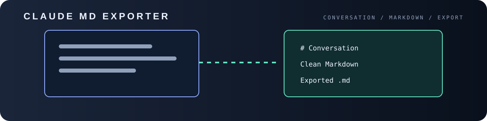

# Claude MD Exporter

<p align="center"></p>

A privacy-focused bookmarklet that exports the **currently open Claude.ai conversation** to a Markdown (`.md`) file.

**[Open the installation page](https://error404dtir.github.io/claude-md-exporter/)** · [Source code](https://github.com/ERROR404DTIR/claude-md-exporter/blob/main/claude-exporter.js)

## Install

1. Open the [installation page](https://error404dtir.github.io/claude-md-exporter/).
2. Show your browser's bookmarks toolbar (usually `Ctrl+Shift+B` on desktop).
3. Drag the green ** Claude Export** link onto the toolbar.
4. Open a conversation at [claude.ai](https://claude.ai/) while signed in.
5. Click the saved bookmark. Your `.md` file will download.

If dragging is unavailable, use **Copy bookmarklet**, create a bookmark manually, and paste the copied text into its URL/location field.

## Features

- Exports messages on the currently selected conversation branch, in order
- Preserves Claude's source Markdown: code, tables, links, math and formatting
- Includes timestamps and YAML front matter
- Supports artifacts, generated files, visualization widgets and attachment metadata
- Excludes internal `thinking` blocks and tool-result internals

## Privacy and security

- Runs in the open Claude.ai tab using the session already active there.
- Requests conversation data directly from Claude's same-origin API.
- Does not send chat contents to this project, GitHub, analytics, or third-party servers.
- Does not load remote JavaScript when the bookmark is clicked. The source is embedded into the bookmarklet at installation time.
- Creates the Markdown file locally in the browser.

Bookmarklets execute with the permissions of the page on which they run. Review [the source](./claude-exporter.js) before installing and only use bookmarklets you trust.

## Limitations

- Requires a modern browser, an active Claude.ai session and a specific conversation page.
- Depends on an undocumented Claude endpoint; Anthropic may change it.
- Attachment binaries are not bundled. Some attachment links may require the same signed-in Claude account.
- An installed bookmarklet is a snapshot. Revisit the installation page and drag the link again after updates.

## Development

No build step or runtime dependencies. The main script is `claude-exporter.js`; `docs/index.html` loads it and embeds it into the draggable bookmarklet.

Check JavaScript syntax:

```bash
node --check claude-exporter.js
```

## Credits

The exporter logic is adapted from [Claude Chat Exporter](https://github.com/agarwalvishal/claude-chat-exporter) by Vishal Agarwal, distributed under the MIT License. This repository changes the install experience, branding, runtime checks, download handling and documentation. See [NOTICE.md](NOTICE.md).

## Disclaimer

Independent community project; not affiliated with, endorsed by, or supported by Anthropic. Claude and Claude.ai are trademarks of Anthropic.

## License

MIT. See [LICENSE](LICENSE).